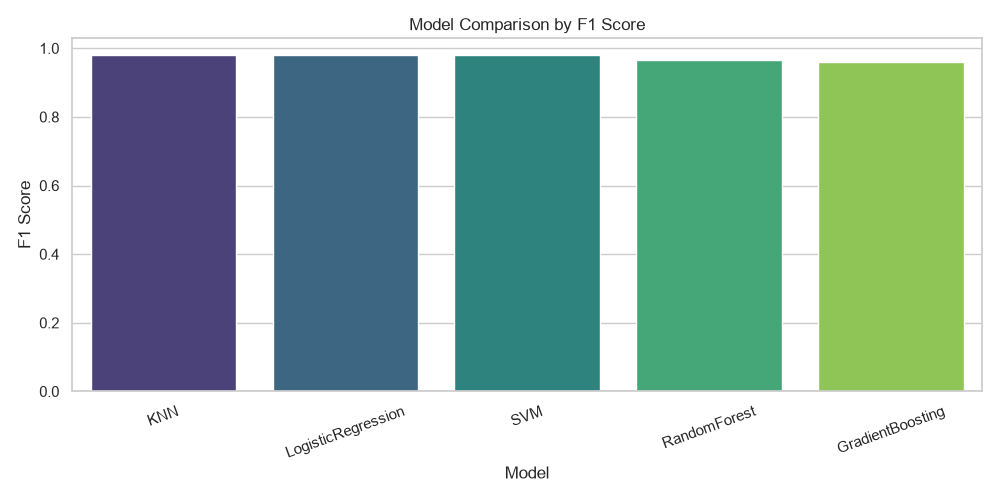

# AutoML Pipeline Generator for Tabular Data


[](https://github.com/SenCruCiAl/AutoML-Pipeline-Generator-for-Tabular-Data/actions)

A production-ready Python project that automates model building for tabular classification datasets. It performs preprocessing, model generation, hyperparameter tuning, evaluation, ranking, visualization, and best-model persistence through a command-line interface.

## Project Overview

This project takes a CSV dataset and target column, then:

1. Loads and validates data.
2. Builds a robust preprocessing pipeline:
   - Missing value imputation
   - Categorical feature encoding
   - Numeric standardization
3. Generates multiple candidate ML models.
4. Runs `GridSearchCV` for each candidate.
5. Evaluates all models with key metrics.
6. Ranks models and saves results to disk.
7. Selects and persists the best model by **F1 score**.

## Architecture

```text
├── data/
│   ├── breast_cancer.csv
│   └── create_sample_dataset.py
├── src/
│   ├── data_loader.py
│   ├── model_generator.py
│   ├── evaluator.py
│   ├── utils.py
│   └── main.py
├── results/
├── models/
├── requirements.txt
├── docs/
├── README.md
└── .gitignore
```

### Module Responsibilities

- `data_loader.py`: Data ingestion, validation, train/test split, and preprocessing pipeline creation.
- `model_generator.py`: Candidate classifier and parameter-grid definitions.
- `evaluator.py`: Grid-search training, cross-validation, and metric computation.
- `utils.py`: Logging setup and filesystem helpers.
- `main.py`: CLI entrypoint orchestrating end-to-end workflow.

## Installation

```bash
python -m venv .venv
source .venv/bin/activate  # Windows: .venv\Scripts\activate
pip install -r requirements.txt
```

## How to Run

From the repository root:

```bash
python src/main.py --data data/breast_cancer.csv --target target
```

### CLI Options

- `--data`: Path to CSV file.
- `--target`: Target column name.
- `--test-size`: Test split ratio (default: `0.2`).
- `--cv`: Number of cross-validation folds (default: `5`).
- `--random-state`: Random seed (default: `42`).
- `--results-dir`: Directory for outputs (default: `results`).
- `--models-dir`: Directory for model artifacts (default: `models`).
- `--log-level`: Logging verbosity (default: `INFO`).

## Results (bundled breast-cancer dataset, 569 rows)

| Model | Accuracy | F1 | ROC-AUC | CV F1 |
|---|---|---|---|---|
| KNN | 0.974 | 0.980 | 0.988 | 0.978 |
| LogisticRegression | 0.974 | 0.979 | 0.996 | 0.985 |
| SVM | 0.974 | 0.979 | 0.995 | 0.981 |
| RandomForest | 0.956 | 0.966 | 0.993 | 0.967 |
| GradientBoosting | 0.947 | 0.959 | 0.991 | 0.977 |



## Example Output

After successful execution:

- `results/results.csv`: Ranked model comparison table.
- `results/model_comparison.png`: F1 score comparison bar chart.
- `models/best_model.pkl`: Persisted best model.

Example result table columns:

- `model`
- `best_params`
- `accuracy`
- `precision`
- `recall`
- `f1_score`
- `roc_auc`
- `cv_mean_f1`
- `cv_std_f1`

## Future Improvements

- Add support for regression workflows.
- Add experiment tracking (e.g., MLflow).
- Introduce parallelized model search strategies (RandomizedSearchCV/Optuna).
- Export automated HTML reports.
- Add unit tests (a CI smoke test already runs the pipeline end-to-end).

## Notes

- A sample breast-cancer CSV is included at `data/breast_cancer.csv`.
- If you need to regenerate it directly from sklearn, run:

```bash
python data/create_sample_dataset.py
```
